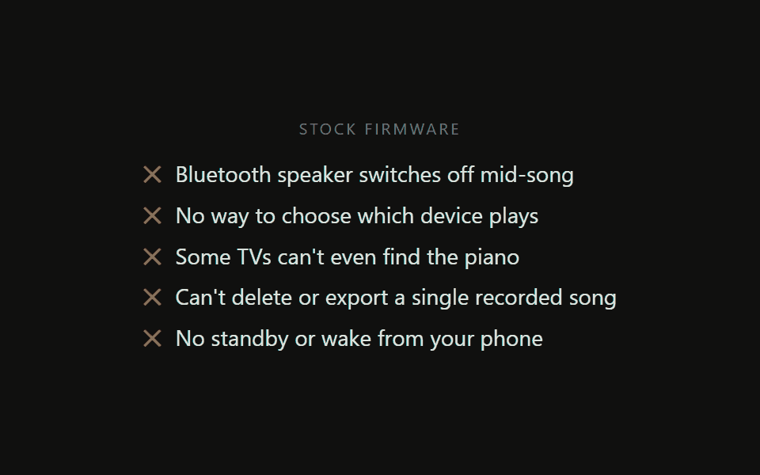
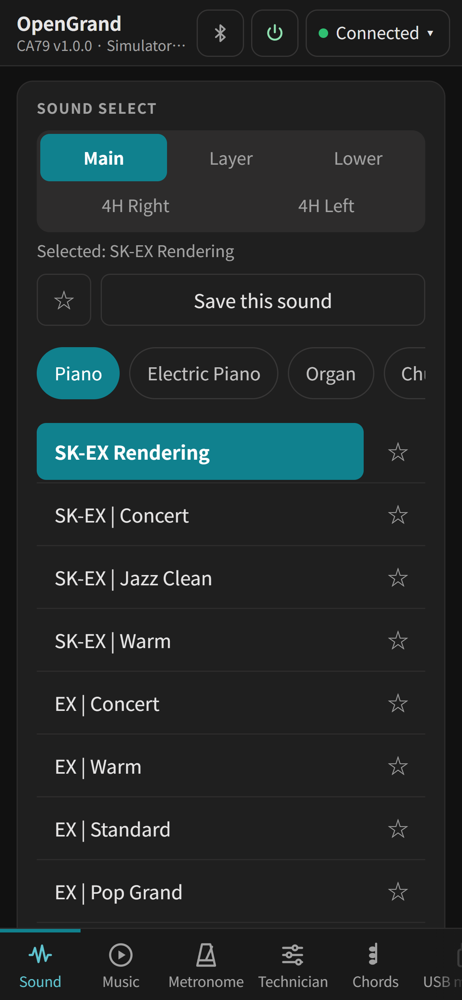
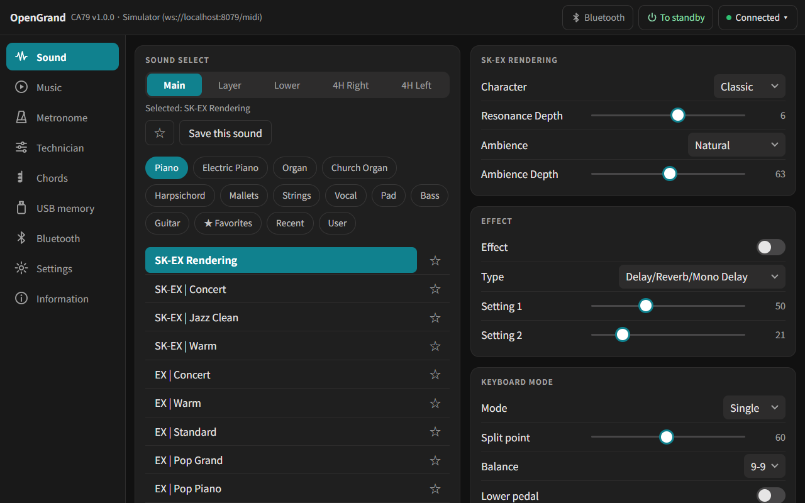

# OpenGrand

**Unofficial open firmware extension & remote app for Kawai CA79 / CA99**

[한국어](docs/README.ko.md) · [Building](docs/BUILDING.md) · [Flashing](docs/FLASHING.md) · [Safety](docs/SAFETY.md) · [Contributing](docs/CONTRIBUTING.md)

> **Not affiliated with, endorsed by, or sponsored by Kawai Musical Instruments Mfg. Co., Ltd.**
> "Kawai", "CA79", "CA99", "NV5S", "NV10S" and other product names are trademarks of their respective
> owner and are used here only to describe compatibility.

> **Warning.** OpenGrand modifies your instrument's system firmware. It may permanently damage
> ("brick") your instrument and will likely void your warranty. Use it entirely at your own risk.
> Read [SAFETY.md](docs/SAFETY.md) before you build or flash anything.



## Why

Kawai's own FAQ says: *"If your piano is connected via Bluetooth MIDI or Bluetooth Audio, the Auto Power
Off setting is still observed."* So a CA79/CA99 used as a Bluetooth speaker switches itself off in the
middle of a song, and the official workaround is to turn Auto Power Off off altogether. Owners have also
asked for years for things the stock software cannot do: deleting single recorder songs, copying them to
USB, keeping settings across power cycles, controlling the piano from a phone without the original app.

OpenGrand is a small extension that runs alongside Kawai's own system firmware (it does not replace it),
plus a new, independent remote app.

## How it compares

| | Stock firmware + official app | With OpenGrand |
|---|---|---|
| **Bluetooth speaker use** | Auto Power Off still fires - the piano switches off mid-song | Stays on while audio is actually playing |
| **Which device plays** | No way to choose. The Bluetooth module plays one stream at a time, and a second device that starts playing is silently ignored | Pick the device in the app; the speaker is handed over without disconnecting anyone (phone to PC measured at 3.5-5 s) |
| **TVs** | An Android TV we tested did not even list the piano as an audio device (the module announces an "unclassified" device type) | The piano announces itself as a loudspeaker, so the TV finds it - and TV sound can wake the piano from standby |
| **Reconnecting** | Left to the module's fixed auto-call | Reconnects your preferred or last device after power-on and after waking |
| **Recorder songs** | No single-song delete, no copy to USB | List, play, delete, export as Standard MIDI Files |
| **Power from the sofa** | Walk to the piano | Standby and wake from the app |
| **Several controllers** | - | Phone, PC and the built-in panel stay in sync |
| **App size** | Android app about 85 MB | Android app 3 MB; the web app is 0.6 MB (about 150 KB compressed) and opens in well under a second |
| **Where it runs** | iOS, Android | Web (installable PWA), Windows, Android |
| **Updates** | USB stick | Over Bluetooth, two slots (A/B) with automatic fallback |

The stock column describes Kawai system software V2.19 as we observed it on a CA79, plus Kawai's own FAQ.
OpenGrand does not run on iOS (no Web Bluetooth there).

## What it does

**On the piano (firmware extension)**
- **Stays on while Bluetooth audio is actually playing** - Auto Power Off is held off only while audio
  streams, and works normally otherwise.
- **Remote standby and wake** - put the piano into a quiet standby from the app; wake it with a key, the
  power button, the app, or (optionally) when a Bluetooth audio source such as a TV starts streaming.
- **Startup settings restore** - the piano can come up with the settings you chose, instead of resetting.
- **Several controllers at once** - phone, PC and the built-in panel stay in sync.
- **Bluetooth updates of the extension itself** - after one USB install (a single file that already carries every
  feature), new versions of the features *and of the update loader* are uploaded over Bluetooth into one of two
  slots (A/B). A new version must prove itself before it is kept; a version that fails to start is skipped
  automatically and the previous one runs again. Only a small fixed part stays as the USB install put it.
- **Escape keys** - hold **A0 + A#0** while switching on for safe mode (the older loader, without the main
  features), or **A0 + A#0 + B0** (the three lowest keys) to start pure stock for that power-on.

**Remote app (web / Windows / Android)**
- Full panel-style control of sounds, effects, metronome, recorder and settings over Bluetooth MIDI or USB.
- **Bluetooth audio source switching** - see the paired audio sources and hand the speaker over from one
  device (phone, tablet, TV) to another.
- **Recorder song manager** - list, play, delete single internal recorder songs and export them as Standard
  MIDI Files.
- **USB memory browser** - list, play, rename, delete and copy files on the USB stick in the piano.
- **Settings profiles** - save settings and choose what the piano restores at startup.
- **Bluetooth firmware updates** - upload, confirm and roll back the extension from the app.
- Runs as an installable web app (PWA) in Chrome, as a portable Windows app, and as an Android app.
  A built-in simulator lets you try the app without a piano.

**Advanced: replacement LCD panel UI** - the same app can replace the screen shown on the piano's built-in
touch panel. Installing it requires a key you must supply yourself; it is not included in, and is not
derived by, this repository. Most users do not need this.

| Phone | Desktop |
|---|---|
|  |  |

*Screenshots use the built-in simulator.*

## Under the hood

OpenGrand is not a patched app or a hex edit. It is a second firmware that lives next to Kawai's own, with its
own update system, and it was built to be hard to brick.

- **Runs beside the stock firmware, not instead of it.** The extension is placed in memory the stock image does
  not use and hooks in at a handful of audited points. Hold the three lowest keys at power-on and the piano runs
  pure stock.
- **Its own A/B update system.** A fixed first stage of about 4 KB picks between two loader slots and two feature
  slots. Every payload is signed (HMAC) with a key generated on *your* machine. A new version must confirm itself
  after boot; three failed starts and the piano falls back to the previous slot on its own.
- **Updates over Bluetooth MIDI.** The 106 KB feature image uploads in about 44 seconds (compressed, windowed
  transfer) and can be applied without switching the piano off.
- **Tested against the real firmware before it touches a piano.** A Unicorn-based harness runs the stock ARM code
  together with the extension; 32 round-trip scripts exercise updates, rollback, power handling and Bluetooth
  audio. The full check runs 43 suites, and every image is reproducible byte for byte and compared with recorded
  hashes.
- **One C core, three targets.** The same C11 core (about 23,000 lines) builds for the piano, for host tests and
  for a Linux simulator - the simulator behind the app's built-in demo mode.
- **One protocol source.** 209 parameters, 67 sounds and 100 rhythms are described once and generated into C,
  TypeScript and documentation, so the piano and the app cannot drift apart.
- **A real Bluetooth audio manager.** The extension talks to the piano's Bluetooth module directly: it tracks
  every connected source, hands the speaker over without dropping links, and reconnects by policy.
- **A small, fast app.** About 16,000 lines of TypeScript with no UI framework; the same code runs as a web app,
  on Windows, on Android, and on the piano's own touch panel (a Chrome 71 WebView).

The remote protocol is documented in [REMOTE_PROTOCOL.md](result/protocol/REMOTE_PROTOCOL.md) and the design in
[ARCHITECTURE.md](result/ARCHITECTURE.md).

## Supported models

| Model | System file | Status |
|---|---|---|
| **CA79** | `CAx9_P06.SYS` V2.19 | Supported - developed and tested on this model |
| **CA99** | `CAx9_P06.SYS` V2.19 | Supported - same system file as the CA79; less field testing |
| NV5S, NV10S | `CAx9_P06.SYS` V2.19 | Expected to work (same system file), untested - reports welcome |
| CA701, CA901 | separate "CA901/CA701" system file | **Not supported** (similar panel, different firmware) |
| CA49, CA59, CA401, CA501, CAx8 and others | - | **Not supported** |

Only Kawai's system software **V2.19** is supported. Every build step checks the SHA-256 of your
`CAx9_P06.SYS` and refuses anything else.

## No Kawai content in this repository

**This repository contains no Kawai firmware, code, keys or assets. You supply your own legally obtained
files.** The build reads your copy of Kawai's official system update (`CAx9_P06.SYS`), applies OpenGrand's
own code to it on your machine, and writes an image for your own piano. Patched images are never
distributed - please do not share yours either. The remote app is an independent implementation that
speaks the piano's MIDI/SysEx protocol.

## Quick start

1. Read [SAFETY.md](docs/SAFETY.md).
2. Just want to look? Build the app and open the simulator - no piano needed:
   ```bash
   cd result/app && npm ci && npm run build && npm run dev   # then open http://localhost:8079/?sim
   ```
3. Build the firmware images from your own copy of Kawai's V2.19 update: [BUILDING.md](docs/BUILDING.md).
4. Install once over USB - one file, `opengrand_install.SYS`, with every feature already in it - then update over
   Bluetooth: [FLASHING.md](docs/FLASHING.md).
5. Going back to stock is always Kawai's official USB update procedure: [FLASHING.md#full-recovery](docs/FLASHING.md#full-recovery).

## Repository layout

```
result/
├── firmware/   C11 core (power policy, sessions, recorder, settings store, update container)
│               + Linux simulator + host tests
├── stockfw/    builds the piano images on your machine: extension code ("cave"), linker scripts,
│               patch definitions, Bluetooth-update packer, emulator round-trip tests
├── app/        TypeScript remote app (web/PWA), Android shell (android/), panel UI packaging
├── desktop/    Windows desktop shell (Electron around the built web app)
└── protocol/   single source of truth for parameters (spec/ca79.json), code generator,
                remote protocol specification
scripts/        check runner, leak check, git hooks
```

Many design notes under `result/` are currently written in Korean.

## License

OpenGrand is free software under the [GNU General Public License v3.0](LICENSE), with an
[additional permission](LICENSE-EXCEPTION.md) (GPLv3 section 7) for combining it with your copy of
Kawai's proprietary system firmware. Commercial licenses for proprietary use are available - see
[COMMERCIAL.md](docs/COMMERCIAL.md). Contributions require a [CLA](docs/CLA.md) - see [CONTRIBUTING.md](docs/CONTRIBUTING.md).
Third-party notices: [NOTICE](docs/NOTICE).

THIS SOFTWARE IS PROVIDED "AS IS", WITHOUT WARRANTY OF ANY KIND. See [SAFETY.md](docs/SAFETY.md) and sections
15-16 of the GPL.
