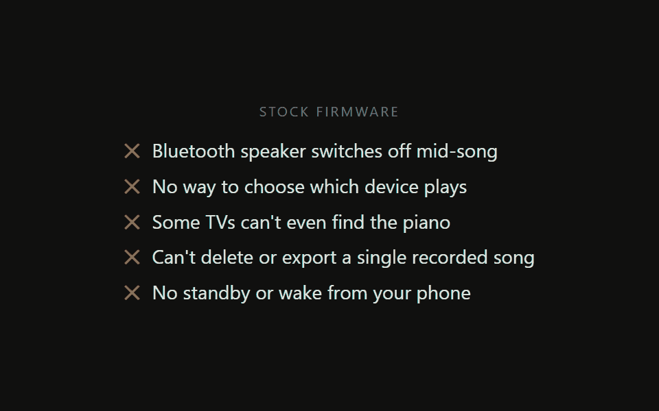
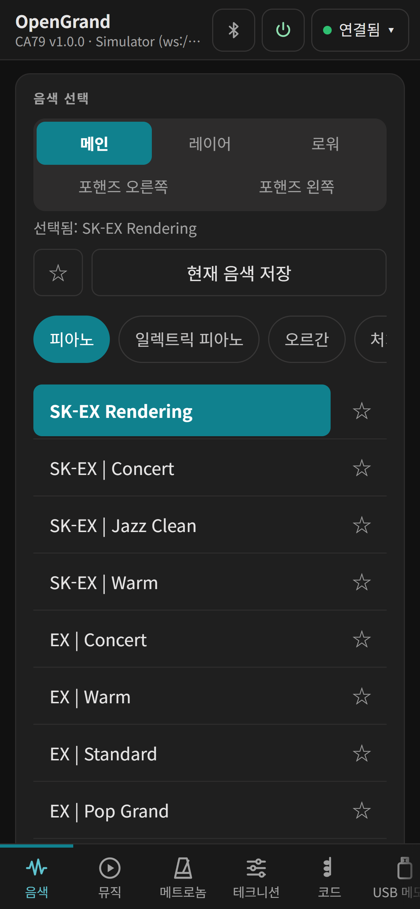
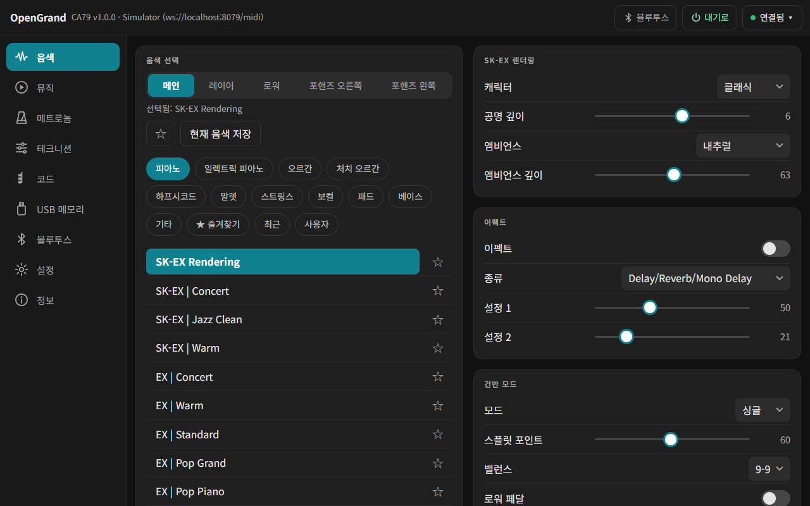

# OpenGrand

**가와이 CA79 / CA99용 비공식 오픈 펌웨어 확장 · 원격 앱**
(Unofficial open firmware extension & remote app for Kawai CA79 / CA99)

[English](../README.md) · [빌드 (BUILDING)](BUILDING.md) · [설치 (FLASHING)](FLASHING.md) · [안전 (SAFETY)](SAFETY.md) · [기여 (CONTRIBUTING)](CONTRIBUTING.md)

> **이 프로젝트는 Kawai Musical Instruments Mfg. Co., Ltd.와 관계가 없으며, 가와이가 보증하거나 후원하지 않습니다.**
> "Kawai", "CA79", "CA99", "NV5S", "NV10S" 등 제품 이름은 해당 소유자의 상표이며, 호환 대상을 설명하는 데만 씁니다.

> **경고.** OpenGrand는 악기의 시스템 펌웨어를 수정합니다. 악기가 영구히 고장 날("벽돌") 수 있고,
> 보증을 받지 못하게 될 가능성이 큽니다. 모든 책임은 사용자에게 있습니다.
> 빌드하거나 올리기 전에 [SAFETY.md](SAFETY.md)를 읽어 주세요.



## 왜 만들었나

가와이 공식 FAQ: *"If your piano is connected via Bluetooth MIDI or Bluetooth Audio, the Auto Power Off
setting is still observed."* — 블루투스 오디오를 재생하는 중에도 자동 전원 끄기가 그대로 동작합니다.
그래서 CA79/CA99를 블루투스 스피커로 쓰면 노래 중간에 꺼지고, 공식적인 방법은 자동 전원 끄기를 아예 끄는
것뿐입니다. 녹음곡을 한 곡씩 지우기, USB로 옮기기, 전원을 껐다 켜도 설정 유지하기, 원래 앱 없이 폰으로
제어하기도 오랫동안 요청됐지만 순정 소프트웨어로는 되지 않습니다.

OpenGrand는 가와이 시스템 펌웨어를 **대체하지 않고 그 옆에서 도는** 작은 확장과, 새로 만든 독립 원격 앱입니다.

## 무엇이 달라지나

| | 순정 펌웨어 + 공식 앱 | OpenGrand |
|---|---|---|
| **블루투스 스피커로 쓸 때** | 자동 전원 끄기가 그대로 동작 - 노래 중간에 꺼짐 | 소리가 실제로 나는 동안에는 안 꺼짐 |
| **어느 기기 소리를 낼지** | 고를 방법이 없음. 블루투스 모듈은 한 번에 한 기기 소리만 내고, 두 번째 기기가 재생해도 말없이 무시됨 | 앱에서 기기를 고름. 아무도 끊지 않고 스피커를 넘김(폰 → PC 실측 3.5-5초) |
| **TV** | 시험한 안드로이드 TV는 피아노를 오디오 기기 목록에 띄우지도 않음(모듈이 기기 종류를 "미분류"로 알림) | 피아노가 스피커로 알려져 TV가 찾음. TV 소리로 대기 중인 피아노를 깨울 수도 있음 |
| **다시 연결** | 모듈의 고정된 자동 연결에 맡김 | 켤 때와 대기에서 깰 때 선호 기기 · 마지막 기기를 다시 부름 |
| **녹음곡** | 한 곡 삭제 · USB 복사 불가 | 목록 · 재생 · 삭제 · 표준 MIDI 파일로 내보내기 |
| **전원** | 피아노까지 가야 함 | 앱에서 대기 · 깨우기 |
| **여러 조작기** | - | 폰 · PC · 내장 패널이 서로 맞춰짐 |
| **앱 크기** | 안드로이드 앱 약 85 MB | 안드로이드 앱 3 MB, 웹 앱 0.6 MB(압축 약 150 KB) - 1초 안에 열림 |
| **실행 환경** | iOS, 안드로이드 | 웹(설치형 PWA), Windows, 안드로이드 |
| **업데이트** | USB 메모리 | 블루투스로, 두 칸(A/B) · 실패하면 자동으로 이전 판 |

순정 쪽 칸은 CA79에서 직접 관찰한 가와이 시스템 소프트웨어 V2.19의 동작과 가와이 공식 FAQ를 기준으로 썼습니다.
OpenGrand는 iOS에서는 동작하지 않습니다(Web Bluetooth 없음).

## 기능

**피아노 쪽 (펌웨어 확장)**
- **블루투스 오디오가 실제로 재생되는 동안에는 꺼지지 않음** — 재생 중에만 자동 전원 끄기를 미루고, 그 밖에는 평소대로.
- **원격 대기 · 깨우기** — 앱에서 조용한 대기 상태로 두고, 건반 · 전원 버튼 · 앱 · (선택) TV 같은 블루투스 오디오 소스의 재생 시작으로 깨움.
- **시작 설정 복원** — 켤 때 초기화 대신 고른 설정으로 시작.
- **여러 컨트롤러 동시 연결** — 폰 · PC · 내장 패널이 서로 동기화.
- **확장 자체의 블루투스 업데이트** — USB로 한 번(모든 기능이 들어 있는 파일 하나) 설치한 뒤에는 새 판을 블루투스로
  두 슬롯(A/B) 중 하나에 올립니다.
  새 판은 정상 동작이 확인돼야 유지되고, 시작에 실패하는 판은 자동으로 건너뛰어 이전 판이 다시 돕니다.
- **탈출 건반** — 전원을 켤 때 **A0 + A#0**을 누르고 있으면 안전 모드(옛 로더, 메인 기능 없이), **A0 + A#0 + B0**(맨 아래 세 건반)이면 그 전원 동안 순정 그대로 시작.

**원격 앱 (웹 / Windows / Android)**
- 블루투스 MIDI 또는 USB로 음색 · 효과 · 메트로놈 · 녹음기 · 설정을 패널처럼 제어.
- **블루투스 오디오 소스 전환** — 페어링된 오디오 기기를 보고 스피커를 폰 · 태블릿 · TV 사이에서 넘김.
- **녹음곡 관리** — 내장 녹음곡 목록 · 재생 · 한 곡씩 삭제 · SMF(표준 MIDI 파일)로 내보내기.
- **USB 메모리 보기** — 피아노에 꽂힌 USB의 파일 목록 · 재생 · 이름 바꾸기 · 삭제 · 복사.
- **설정 프로필** — 설정을 저장하고 켤 때 복원할 설정을 고름.
- **블루투스 펌웨어 업데이트** — 앱에서 올리기 · 확인 · 되돌리기.
- Chrome의 설치형 웹 앱(PWA), 휴대용 Windows 앱, Android 앱으로 동작. 내장 시뮬레이터로 피아노 없이 써 볼 수 있습니다.

**고급: LCD 패널 UI 교체** — 같은 앱으로 피아노 내장 터치 패널의 화면을 바꿀 수 있습니다. 설치에는 사용자가 직접
준비해야 하는 키가 필요하며, 그 키는 이 저장소에 들어 있지 않고 이 저장소로 만들어 낼 수도 없습니다. 대부분은 필요 없습니다.

| 폰 | 데스크톱 |
|---|---|
|  |  |

*화면은 앱에 들어 있는 시뮬레이터로 찍었습니다.*

## 내부 구조

OpenGrand는 앱을 고친 것도, 바이너리 몇 바이트를 바꾼 것도 아닙니다. 가와이 펌웨어 옆에서 도는 두 번째 펌웨어이고,
자체 업데이트 시스템을 갖추었으며, 벽돌이 되기 어렵게 만들었습니다.

- **순정 펌웨어를 대체하지 않고 옆에서 돕니다.** 확장은 순정 이미지가 쓰지 않는 메모리에 놓이고, 검증한 몇 군데에서만
  끼어듭니다. 가장 낮은 건반 셋을 누른 채 켜면 순정 그대로 돕니다.
- **자체 A/B 업데이트.** 약 4 KB의 고정된 첫 단계가 로더 두 칸과 기능 두 칸 중 하나를 고릅니다. 모든 페이로드는
  *사용자 PC에서 만든* 키로 서명(HMAC)됩니다. 새 판은 부팅 뒤 스스로 확인해야 하고, 세 번 시작에 실패하면
  피아노가 알아서 이전 칸으로 돌아갑니다.
- **블루투스 MIDI로 업데이트.** 106 KB 기능 이미지를 약 44초에 올리고(압축 · 창 전송), 피아노를 끄지 않고 적용합니다.
- **피아노에 올리기 전에 실제 펌웨어로 시험합니다.** Unicorn 기반 하네스가 순정 ARM 코드와 확장을 함께 돌리고,
  왕복 시험 32개가 업데이트 · 되돌리기 · 전원 · 블루투스 오디오를 확인합니다. 전체 검사는 43개 묶음이며, 모든 이미지는
  바이트 단위로 재현되고 기록된 해시와 비교됩니다.
- **C 코어 하나, 대상 셋.** 같은 C11 코어(약 23,000줄)가 피아노, 호스트 시험, 리눅스 시뮬레이터로 빌드됩니다.
  앱의 체험 모드가 이 시뮬레이터입니다.
- **프로토콜 원본 하나.** 파라미터 209개 · 음색 67개 · 리듬 100개를 한 곳에 적고 C · TypeScript · 문서를 생성해,
  피아노와 앱이 어긋나지 않습니다.
- **블루투스 오디오 관리자.** 확장이 피아노의 블루투스 모듈과 직접 통신해 연결된 기기를 모두 추적하고, 링크를 끊지
  않고 스피커를 넘기며, 정한 규칙대로 다시 연결합니다.
- **작고 빠른 앱.** UI 프레임워크 없이 TypeScript 약 16,000줄. 같은 코드가 웹 앱, Windows, 안드로이드, 피아노의
  터치 패널(Chrome 71 WebView)에서 돕니다.

원격 프로토콜은 [REMOTE_PROTOCOL.md](../result/protocol/REMOTE_PROTOCOL.md), 설계는
[ARCHITECTURE.md](../result/ARCHITECTURE.md)에 있습니다.

## 지원 기종

| 기종 | 시스템 파일 | 상태 |
|---|---|---|
| **CA79** | `CAx9_P06.SYS` V2.19 | 지원 — 이 기종으로 개발 · 실기 시험 |
| **CA99** | `CAx9_P06.SYS` V2.19 | 지원 — CA79와 같은 시스템 파일, 실사용 시험은 적음 |
| NV5S, NV10S | `CAx9_P06.SYS` V2.19 | 동작 예상(같은 시스템 파일), 미시험 — 결과를 알려 주세요 |
| CA701, CA901 | 별도 "CA901/CA701" 시스템 파일 | **미지원** (패널은 비슷하지만 펌웨어가 다름) |
| CA49, CA59, CA401, CA501, CAx8 등 | — | **미지원** |

가와이 시스템 소프트웨어 **V2.19**만 지원합니다. 모든 빌드 단계가 `CAx9_P06.SYS`의 SHA-256을 검사하고 다르면 거부합니다.

## 이 저장소에는 가와이 자료가 없습니다

**이 저장소에는 가와이의 펌웨어 · 코드 · 키 · 자산이 전혀 들어 있지 않습니다. 합법적으로 받은 파일은 사용자가 직접
준비합니다.** 빌드는 사용자가 받은 가와이 공식 시스템 업데이트(`CAx9_P06.SYS`)를 읽어 사용자 PC에서 OpenGrand 코드를
덧붙이고, 자기 피아노용 이미지를 만듭니다. 수정된 이미지는 배포하지 않으며, 만든 이미지를 남에게 나눠 주지 말아 주세요.
원격 앱은 피아노의 MIDI/SysEx 프로토콜로 통신하는 독립 구현입니다.

## 빠른 시작

1. [SAFETY.md](SAFETY.md)를 읽습니다.
2. 구경만 하려면 앱을 빌드해 시뮬레이터를 엽니다 — 피아노가 없어도 됩니다:
   ```bash
   cd result/app && npm ci && npm run build && npm run dev   # 그다음 http://localhost:8079/?sim
   ```
3. 직접 받은 가와이 V2.19 업데이트로 펌웨어 이미지를 빌드합니다: [BUILDING.md](BUILDING.md).
4. USB로 한 번 설치하고(파일 하나, 모든 기능이 이미 들어 있는 `opengrand_install.SYS`), 그 뒤로는 블루투스로
   업데이트합니다: [FLASHING.md](FLASHING.md).
5. 순정으로 돌아가는 방법은 언제나 가와이 공식 USB 업데이트입니다: [FLASHING.md#full-recovery](FLASHING.md#full-recovery).

## 저장소 구성

```
result/
├── firmware/   C11 코어(전원 정책 · 세션 · 녹음기 · 설정 저장소 · 업데이트 컨테이너)
│               + Linux 시뮬레이터 + 호스트 테스트
├── stockfw/    사용자 PC에서 피아노 이미지를 만드는 도구: 확장 코드("cave") · 링커 스크립트 ·
│               패치 정의 · 블루투스 업데이트 패커 · 에뮬레이터 왕복 시험
├── app/        TypeScript 원격 앱(웹/PWA) · Android 셸(android/) · 패널 UI 패키징
├── desktop/    Windows 데스크톱 셸(빌드한 웹 앱을 감싼 Electron)
└── protocol/   파라미터 단일 원천(spec/ca79.json) · 코드 생성기 · 원격 프로토콜 명세
scripts/        검사 실행기 · 유출 검사 · git 훅
```

## 라이선스

OpenGrand는 [GNU GPL v3.0](../LICENSE) 자유 소프트웨어이며, 사용자의 가와이 독점 시스템 펌웨어와 결합하는 것을 허용하는
[추가 허가](../LICENSE-EXCEPTION.md)(GPLv3 제7조)가 붙어 있습니다. 독점 용도의 상용 라이선스는 [COMMERCIAL.md](COMMERCIAL.md)를
보세요. 기여에는 [CLA](CLA.md)가 필요합니다 — [CONTRIBUTING.md](CONTRIBUTING.md). 제3자 고지: [NOTICE](NOTICE).

이 소프트웨어는 어떠한 보증도 없이 "있는 그대로" 제공됩니다. [SAFETY.md](SAFETY.md)와 GPL 제15–16조를 보세요.
